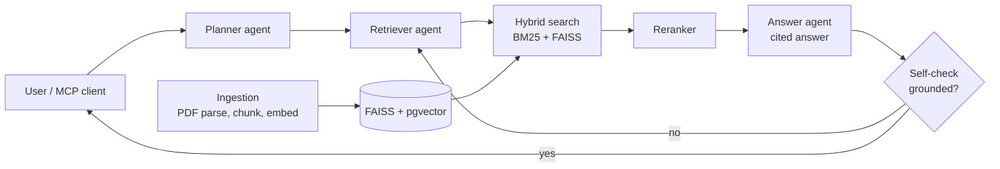

# Agentic RAG Assistant

> **Status: in active development.** v0.1 target: 26 Oct 2026. The roadmap below tracks progress.

A multi-agent question-answering assistant over **RBI and SEBI regulatory circulars**.
It answers only from the source documents, cites every claim, refuses questions outside its scope, and is measured by an automated evaluation suite.
It is also exposed as an **MCP server**, so Claude and other AI clients can use it as a tool.

Built entirely on **free and open-source** components: Groq's free tier with a local Ollama fallback for the LLM, CPU embeddings and reranking, and self-hosted PostgreSQL and Arize Phoenix.

**Design:** [docs/architecture.md](docs/architecture.md)

## Why

Regulatory text is long, cross-referenced and constantly amended, which is exactly where plain vector search breaks down.
This project tests what actually improves answer quality on hard documents (hybrid search, reranking, agentic re-querying) and **measures** each change instead of guessing.

## Architecture

## Features

- **Ingestion pipeline:** PDF parsing, chunking, embeddings, with metadata stored in pgvector and a FAISS index.
- **Multi-agent LangGraph flow:** a planner, retriever and answer agent with a grounding self-check; it re-queries when retrieval is weak.
- **Hybrid semantic search:** BM25 keyword search combined with FAISS vectors, followed by a reranker.
- **Guardrails:** every claim cited, out-of-scope questions refused, PII masked in logs.
- **Summarization tool:** summarizes a full circular on request.
- **Evaluation suite:** RAGAS faithfulness, answer relevance, and context precision and recall on a golden question set.
- **MCP server:** `search_documents`, `ask` and `summarize_circular` tools.

## Tech stack

Python · LangGraph · Groq (free tier) + Ollama · fastembed (bge-small, MiniLM reranker) · FAISS · PostgreSQL + pgvector · BM25 · RAGAS · FastAPI · MCP Python SDK · Streamlit · OpenTelemetry + Arize Phoenix · Docker Compose · pytest · GitHub Actions

## Evaluation

| Retrieval setup | Faithfulness | Answer relevance | Context precision | Context recall |
|---|---|---|---|---|
| Dense only (pgvector) | TBD | TBD | TBD | TBD |
| Dense only (FAISS) | TBD | TBD | TBD | TBD |
| BM25 only | TBD | TBD | TBD | TBD |
| Hybrid (BM25 + FAISS) | TBD | TBD | TBD | TBD |
| Hybrid + rerank | TBD | TBD | TBD | TBD |
| **Full agentic (planner, re-query, verifier)** | TBD | TBD | TBD | TBD |

*Results will be published here when the eval suite runs.*

## Roadmap

- [ ] Ingestion pipeline (RBI and SEBI circulars to FAISS and pgvector)
- [ ] Baseline RAG endpoint
- [ ] Hybrid search and reranker
- [ ] Multi-agent LangGraph flow with self-check
- [ ] Guardrails and summarization tool
- [ ] Golden question set and RAGAS evaluation
- [ ] MCP server
- [ ] Streamlit UI
- [ ] pytest suite and GitHub Actions CI
- [ ] Docker Compose one-command setup

## Quick start

*Coming with v0.1:* `docker compose up`

## Disclaimer

For research and demonstration only. Not legal or financial advice. Always refer to the official RBI and SEBI publications.

## License

MIT
