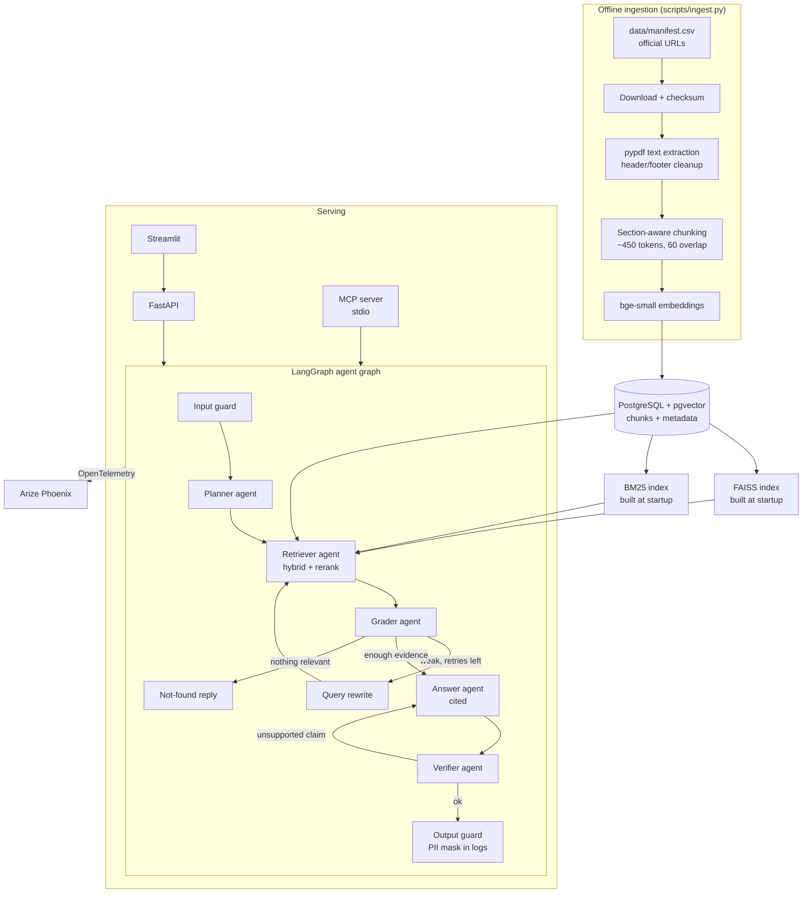

# Agentic RAG Assistant: Architecture and Design

*Status: design final, ready for implementation planning. Date: 19 Oct 2026. Author: Aryan Kansal.*

## 1. Intent

A question-answering assistant over Indian financial regulation: **RBI and SEBI circulars**.
It answers only from the source documents, cites every claim down to the circular and page, says "not found in the corpus" rather than guessing, and is measured by an automated evaluation suite.
The same capabilities are exposed three ways: a REST API, a Streamlit UI, and an MCP server that Claude Desktop or Claude Code can call as a tool.

The project is a portfolio piece aimed at GenAI engineering roles at IT services firms with large banking and finance clients (e.g. Coforge). It must prove:
1. Retrieval engineering beyond "embed and top-k": hybrid search, reranking, metadata filters.
2. Agentic orchestration with LangGraph: planning, grading, re-querying, verification.
3. Evaluation discipline: a human-verified golden set, RAGAS metrics, and an ablation table that shows what each component adds.
4. Responsible AI basics: grounded answers, refusals, PII handling.

## 2. Goals, non-goals, anti-goals

**Goals**
- Cited answers in the form `[1]`, `[2]`, each mapped to a circular number, title, date, page and source URL.
- An ablation table: dense only → BM25 only → hybrid → hybrid + rerank → full agentic, measured on the same golden set.
- MCP server with `search_documents`, `ask` and `summarize_circular` tools.
- One-command local setup, with tests and lint passing in GitHub Actions.

**Non-goals**
- Legal advice, or a complete regulatory corpus. The scope is a bounded topic set (section 5.1).
- User accounts, chat history persistence, multi-user deployment.
- Fine-tuning any model.
- OCR of scanned PDFs: documents without a text layer are skipped and listed in the ingestion report.

**Anti-goals** (failures even if the code works)
- **Any paid service or a credit card on file.**
- **An answer containing a claim that its citations do not support.** The verifier must catch this, and the eval must measure it.
- **A golden set written by the same LLM that is being evaluated, without human review.** That makes the eval circular and meaningless.
- **Redistributing the source PDFs.** The repo ships a manifest of official URLs and a download script, never the files.

## 3. Constraints

| Constraint | Effect on design |
|---|---|
| **Free only** | Generation and evaluation use **Groq's free tier**, with a local Ollama `llama3.1:8b` fallback. Embeddings and reranking run locally on CPU. All storage is open source in Docker. |
| **Laptop: RTX 3050 6 GB, 16 GB RAM** | Small CPU-friendly embedding and reranker models via ONNX (`fastembed`). A corpus of about 300–500 pages keeps all indexes in memory. |
| **Free-tier rate limits** | All LLM calls from scripts are cached on disk; the golden set is 60 questions; RAGAS runs are cached per configuration. |
| **~3 days of build time** | BM25 and FAISS live in process; no separate search server. |
| **Must match the resume** | Multi-agent LangGraph, RBI and SEBI circulars, hybrid FAISS + BM25 search, reranking, cited answers, summarization, guardrails, RAGAS on a golden question set, MCP server. pgvector, FastAPI and Docker are also listed. |

## 4. System overview



## 5. Component decisions

### 5.1 Corpus
- **Scope:** RBI and SEBI circulars and master directions on three themes: **KYC / AML**, **digital lending**, and **cybersecurity and IT governance**. Target 40–60 documents and 300–500 pages, from the official sites `rbi.org.in` and `sebi.gov.in`.
- **Why these themes:** they are live topics for banking and finance clients, the documents cross-reference each other (good for testing multi-hop questions), and the scope is small enough to hand-verify a golden set.
- **`data/manifest.csv`** (committed): `doc_id, regulator, circular_no, title, date, theme, url`. The builder curates it by hand from the official listing pages.
- **`scripts/download.py`:** fetches each URL with a polite delay, stores files in `data/raw/` (gitignored), and records a SHA-256 checksum. It never scrapes beyond the manifest.

### 5.2 Parsing and chunking
- **Parser:** `pypdf` (BSD). PyMuPDF extracts text better but is AGPL; pypdf keeps the repo license simple. Pages with fewer than 50 characters of text are flagged as scanned and skipped, and listed in `results/ingest_report.md`.
- **Cleanup:** remove repeated header and footer lines, which are detected as lines appearing on 60% or more of a document's pages.
- **Chunking:** split on numbered section headings first (regulatory text is numbered: "3.", "3.1", "(a)"), then pack into chunks of about 450 tokens with 60 overlap. The section heading is prepended to each chunk so it keeps its context.
- **Chunk metadata:** `doc_id, regulator, circular_no, title, date, theme, page_start, page_end, section, url`.

### 5.3 Storage and indexes
- **PostgreSQL 16 + pgvector** is the **source of truth**. Table `chunks(id, doc_id, text, metadata jsonb, embedding vector(384))`, plus `documents(...)` mirroring the manifest.
- **FAISS** (`IndexFlatIP` on normalised vectors, so exact cosine) is built in memory from Postgres at API startup and cached to `data/faiss.index`. At this corpus size exact search takes under 5 ms, so approximate indexes add complexity for no benefit. The README says so.
- **BM25:** `rank_bm25` (`BM25Okapi`) over the same chunks, built at startup. The tokenizer keeps circular numbers and section references (e.g. `RBI/2024-25/123`, `Section 45`) as single tokens, because exact-match queries on these are common and dense embeddings handle them badly.
- **Why both FAISS and pgvector:** pgvector gives durable storage, SQL metadata filtering and one place to re-index from. FAISS gives fast in-process dense search for the agent loop and the eval sweeps. The eval also reports a pgvector-only dense run, so the comparison is measured, not asserted.

### 5.4 Retrieval pipeline
1. **Metadata pre-filter** (optional): by regulator, theme or date range, when the planner extracts one from the question.
2. **Dense:** FAISS top 30 using a `bge-small-en-v1.5` query embedding (with the model's recommended query instruction prefix).
3. **Sparse:** BM25 top 30.
4. **Fusion:** Reciprocal Rank Fusion with `k = 60`.
5. **Rerank:** cross-encoder over the top 30 fused results, keep the top 6. Default model `Xenova/ms-marco-MiniLM-L-6-v2` (fast on CPU); `BAAI/bge-reranker-base` is a config option.

Each stage can be switched on or off in config. That is what makes the ablation in section 7 possible.

### 5.5 Agent graph (LangGraph)
Agents are LangGraph nodes with their own prompts and typed outputs (Pydantic, using the model's JSON mode). Shared state: `question, filters, sub_queries, evidence[], draft, citations[], retries, verdict, trace_id`.

| Node | Responsibility | Model |
|---|---|---|
| **Input guard** | Rejects clearly out-of-scope questions (embedding similarity to corpus centroid plus a short LLM check), and detects prompt-injection phrasing. | small LLM |
| **Planner** | Splits the question into 1–3 sub-queries, extracts metadata filters, and picks a mode: `answer` or `summarize`. | LLM |
| **Retriever** | Runs the 5.4 pipeline for each sub-query and deduplicates the evidence. | none (code) |
| **Grader** | Scores each chunk as relevant or not. If fewer than 2 are relevant and `retries < 2`, a query rewrite goes back to the retriever. If none are relevant after retries, it returns not-found. | LLM |
| **Answer** | Writes the answer using only the evidence, with a `[n]` marker after every claim. | LLM |
| **Verifier** | For each sentence, checks that a citation exists and that the cited chunk supports it. On failure it allows one regeneration; after that, unsupported sentences are removed and the answer is marked "partial". | LLM |
| **Output guard** | Masks PII (Aadhaar, PAN, phone and email patterns) in **logs and traces**. The answer itself only quotes regulator text. | regex |

- **Summarize mode:** map-reduce over every chunk of one circular, producing a summary of key obligations, applicability and effective dates, with citations.
- **Models:** `llama-3.3-70b-versatile` on Groq for planner, answer and verifier; a smaller Groq model or local `llama3.2:3b` for the guard and grader. All model names are config values; if Groq is unavailable, everything falls back to local `llama3.1:8b`.

### 5.6 Interfaces
- **FastAPI:** `POST /ask {question, filters?}` returns `{answer, citations[], status: answered|partial|not_found, trace_id}`. Also `POST /search`, `POST /summarize {doc_id}` and `GET /health`.
- **Streamlit UI:** a question box, the answer with clickable citation chips that open the official PDF at the cited page (`url#page=N`), an "evidence" expander showing the retrieved chunks with scores, and a sidebar with regulator and theme filters.
- **MCP server:** built with the official MCP Python SDK (`FastMCP`) over stdio. Tools: `search_documents(query, regulator?, k?)`, `ask(question)` and `summarize_circular(doc_id)`. The README includes a ready-to-paste Claude Desktop and Claude Code config.

## 6. Evaluation

### 6.1 Golden set (`eval/golden.jsonl`, committed)
- **60 answerable questions:** 20 per theme, mixing single-fact, multi-hop (needing two circulars), and numeric or date questions. Each has a reference answer and the IDs of the chunks that support it.
- **10 unanswerable questions** that are on-topic but not covered by the corpus, to test refusals.
- **How it is built:** `eval/draft_golden.py` uses an LLM to draft candidate Q&A pairs from sampled chunks. **Aryan then reviews and edits every item by hand** and records the review in a `reviewed_by` field. Unreviewed items are ignored by the eval runner.

### 6.2 Metrics
- **RAGAS:** faithfulness, answer relevancy, context precision and context recall. Pin the RAGAS version in `pyproject.toml`, because its API changes between releases.
- **Own metrics:**
  - **citation precision:** the share of citations that support their sentence (checked by the judge)
  - **refusal accuracy** on the 10 unanswerable questions
  - **p50 and p95 latency**
- **Evaluator LLM:** a Groq free-tier model from a different family than the generator. Every judgment is cached in `eval/cache.sqlite`.

### 6.3 Ablation runs (`eval/run.py --config <name>`)
| Config | Retrieval | Agent loop |
|---|---|---|
| `dense_pgvector` | pgvector top 6 | single pass |
| `dense_faiss` | FAISS top 6 | single pass |
| `bm25` | BM25 top 6 | single pass |
| `hybrid` | FAISS + BM25 with RRF | single pass |
| `hybrid_rerank` | + cross-encoder | single pass |
| `full_agentic` | + rerank | planner, grader with re-query, verifier |

Results go to `results/eval.md` (committed), and the README table is copied from there.

## 7. Repository layout

```
agentic-rag-assistant/
├─ rag/
│  ├─ ingest/      download.py  parse.py  chunk.py  embed.py
│  ├─ retrieval/   dense.py  bm25.py  fusion.py  rerank.py  pipeline.py
│  ├─ agents/      state.py  graph.py  guard.py  planner.py  grader.py  answer.py  verifier.py  summarize.py
│  ├─ llm.py       # AsyncOpenAI clients for Groq and Ollama, fallback
│  ├─ db.py  config.py  telemetry.py  pii.py
├─ api/main.py           # FastAPI
├─ ui/app.py             # Streamlit
├─ mcp_server/server.py  # FastMCP
├─ eval/   golden.jsonl  draft_golden.py  run.py  metrics.py
├─ data/   manifest.csv  (raw/, faiss.index, cache files gitignored)
├─ results/ eval.md  ingest_report.md
├─ sql/init.sql
├─ tests/  unit/  integration/
├─ docker-compose.yml  Dockerfile  pyproject.toml  .env.example
└─ .github/workflows/ci.yml
```

## 8. Tech stack (all free)

| Layer | Choice | License / tier |
|---|---|---|
| Language, packaging | Python 3.12, `uv` | open source |
| Orchestration | LangGraph (with `langchain-core` types only) | MIT |
| LLMs | Groq API; Ollama `llama3.1:8b`, `llama3.2:3b` | free tier, no card; local |
| LLM client | `openai` Python SDK (both providers are OpenAI-compatible) | Apache-2.0 |
| Embeddings and reranker | `fastembed` (ONNX, CPU): `bge-small-en-v1.5`, `ms-marco-MiniLM-L-6-v2` | Apache-2.0 / MIT |
| Vector search | FAISS (`faiss-cpu`), pgvector | MIT / PostgreSQL |
| Keyword search | `rank_bm25` | Apache-2.0 |
| Database | PostgreSQL 16 (`pgvector/pgvector` image), `psycopg` 3 | PostgreSQL / LGPL |
| PDF parsing | `pypdf` | BSD |
| Evaluation | RAGAS | Apache-2.0 |
| API, UI | FastAPI, Streamlit | MIT / Apache-2.0 |
| MCP | official MCP Python SDK | MIT |
| Tracing | OpenTelemetry, OpenInference, Arize Phoenix | Apache-2.0 / Elastic-2.0 (free self-host) |
| Testing, lint, CI | pytest, ruff, GitHub Actions | MIT; free for public repos |

## 9. Testing and CI

- **Unit:** chunker (section splitting, overlap, header removal), BM25 tokenizer (keeps circular numbers intact), RRF maths, citation parsing, PII masking, grader and verifier routing logic using fake LLM responses.
- **Integration:** ingest a 3-page fixture PDF into a Postgres service container, then run `/ask` end to end with a scripted fake LLM. Assert that the citations point at the right chunk and that an unanswerable question returns `not_found`.
- **MCP:** start the server in-process and call each tool through the MCP client.
- **CI** (on push and pull request): `ruff check`, `ruff format --check`, `pytest`. No real LLM calls in CI.

## 10. Delivery plan (3 days)

| Day | Outcome |
|---|---|
| 1 | Manifest curated, download and ingestion into pgvector, FAISS and BM25 built, baseline single-pass `/ask` with citations, CI green |
| 2 | Hybrid search with RRF and rerank, LangGraph agent graph (planner, grader with re-query, answer, verifier), guards, summarize mode, golden set drafted |
| 3 | Golden set hand-reviewed, all ablation runs, `results/eval.md`, MCP server, Streamlit UI, README results table and demo GIF |

## 11. Risks

| Risk | Mitigation |
|---|---|
| Some circulars are scanned images | Skip them and report; curate the manifest towards text PDFs |
| Groq free-tier limits during eval (6 configs × 70 questions, plus judging) | Cache every call; run configs across days if needed; generator and judge can be pointed at local models in config |
| RAGAS API changes | Pin the version; wrap it in `eval/metrics.py` so only one file touches it |
| The verifier is too strict and removes good sentences | Track the "partial" rate in the eval; tune the prompt on 10 dev questions that are not in the golden set |
| Official site layout or URLs change | The manifest stores direct PDF URLs plus checksums; the download report flags failures |

## 12. Left to the builder

- Exact prompts for each agent, within the input and output contracts in 5.5.
- Streamlit visual details.
- Which 40–60 circulars go into the manifest, within the three themes.
- The heading-detection regexes for the chunker.

## 13. Decisions made by Claude, for Aryan to review

1. **Corpus themes:** KYC/AML, digital lending, and cybersecurity, chosen for relevance to banking and finance clients and so the golden set can be hand-verified.
2. **Groq free tier** as the main LLM, with local Ollama fallback, because 8B-class local models are noticeably weaker at citation-faithful answers.
3. **pgvector as the source of truth with FAISS built from it**, with the eval measuring both, so the resume's "FAISS + pgvector" claim is justified by data.
4. **Exact FAISS index** (`IndexFlatIP`), because the corpus is too small to need approximate search.
5. **pypdf instead of PyMuPDF**, to avoid AGPL licensing.
6. **Golden set drafted by an LLM but reviewed by you.** Plan about 2 hours for the review.
7. **PII masking applies to logs and traces only.** The corpus is public regulation and contains no personal data.
8. **No OCR** for scanned PDFs.
